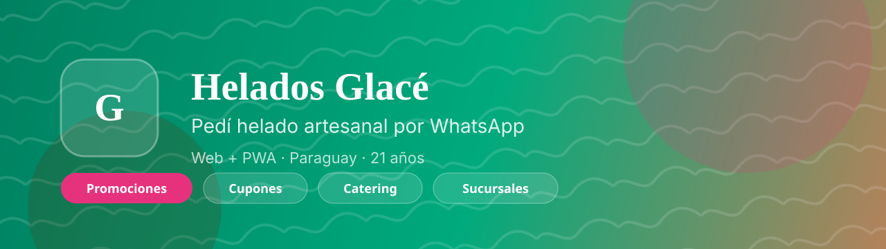
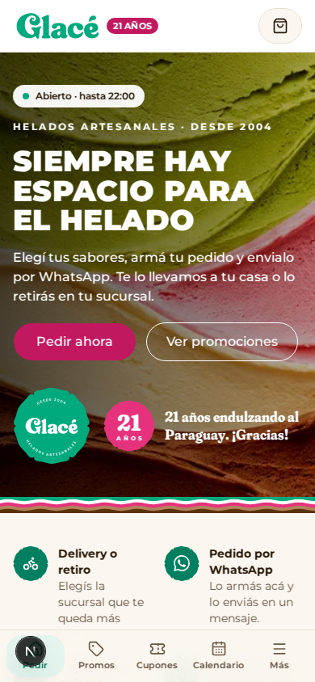
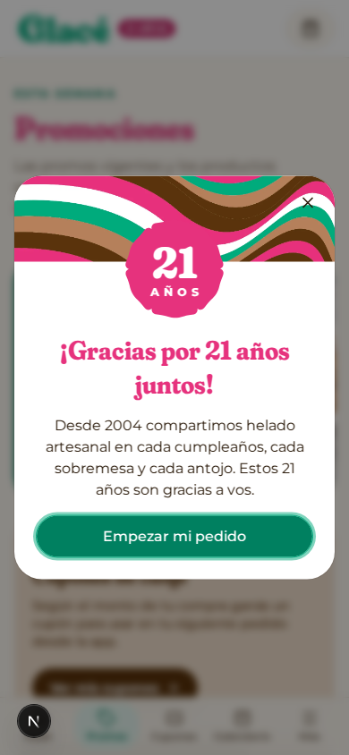
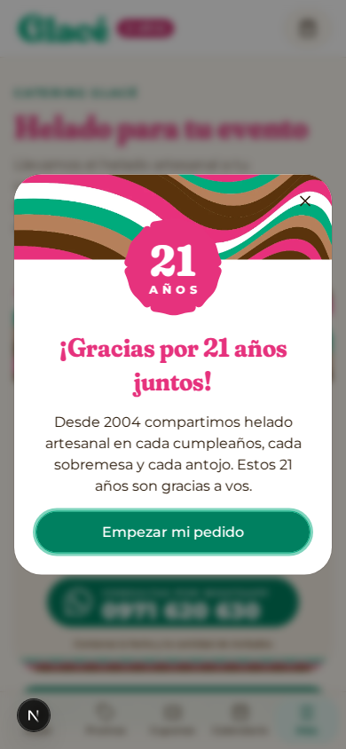
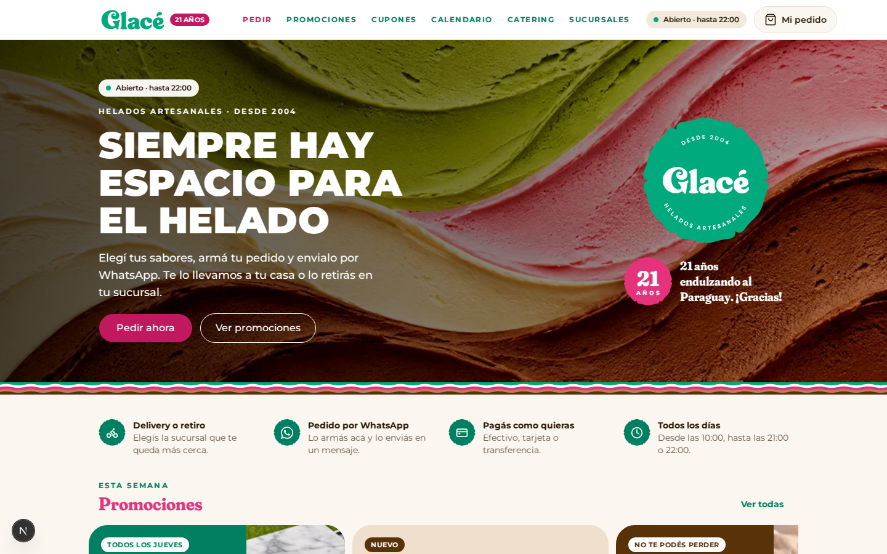
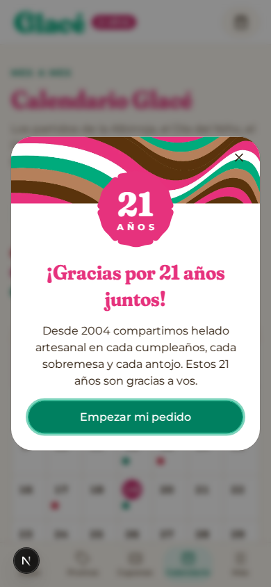
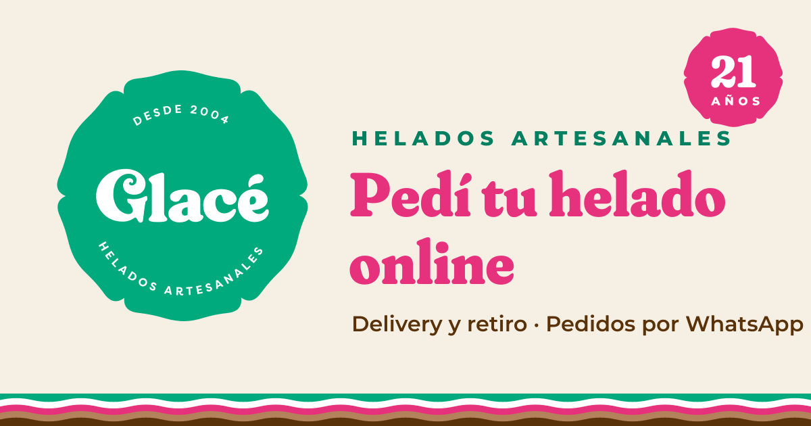
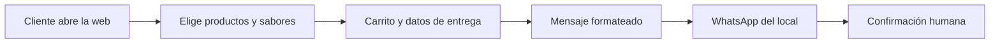

<picture>
  <source media="(prefers-color-scheme: dark)" srcset="docs/github/banner.svg">
  
</picture>

<h1 align="center">Helados Glacé</h1>

<p align="center">
  <strong>Helados artesanales desde 2004 · 21 años</strong><br>
  Tienda web y app instalable (PWA) para pedir delivery, retiro en sucursal, promos, cupones y catering — todo sale por WhatsApp, sin backend.
</p>

<p align="center">
  
  
  
  
  
  
</p>

<p align="center">
  <a href="glace/README.md"><strong>Documentación técnica</strong></a> ·
  <a href="CLAUDE.md"><strong>CLAUDE.md</strong></a> ·
  <a href="docs/claude-einrichtung.md">Claude einbinden (DE)</a> ·
  <a href="https://fiweex.com/delivery/glace">Catálogo original (Fiweex)</a>
</p>

---

## Vista previa

<table>
  <tr>
    <td width="34%" align="center">
      <br>
      <sub><b>Pedir</b> · catálogo, sabores y carrito</sub>
    </td>
    <td width="34%" align="center">
      <br>
      <sub><b>Promociones</b> · destacados y Jueves de Glacé</sub>
    </td>
    <td width="34%" align="center">
      <br>
      <sub><b>Catering</b> · consulta directa por WhatsApp</sub>
    </td>
  </tr>
</table>

<p align="center">
  
</p>

<p align="center">
  
  &nbsp;&nbsp;
  
</p>

---

## Qué incluye

| Módulo | Ruta | Para el cliente |
| --- | --- | --- |
| **Pedir** | `/` | Catálogo Fiweex-style, búsqueda, sabores, carrito y checkout |
| **Promociones** | `/promociones` | Ofertas, destacados y compartir por WhatsApp |
| **Cupones** | `/cupones` | Canje según monto de compra + repetir pedido |
| **Calendario** | `/calendario` | Partidos, feriados, Día del Niño, promos del mes |
| **Catering** | `/catering` | Consultas a **0971 620 630** |
| **Sucursales** | `/sucursales` | Filiales con mapa y horarios |
| **Instalar** | `/instalar` | Guía PWA (iOS, Android, escritorio) |

<details>
<summary><strong>Flujo de pedido (resumen)</strong></summary>



</details>

---

## Marca

Paleta oficial del manual Glacé:

| Color | Hex | Uso |
| --- | --- | --- |
| Verde Glacé | `#00aa7d` | Principal, confianza |
| Rosado | `#e6327d` | Acentos y celebración |
| Castaño | `#b4825a` | Texturas y calidez |
| Marrón | `#5a320a` | Texto y contraste |

Logo vectorial, texturas y badge **21 años** integrados en la UI. Texto accesible en UI: español (Paraguay).

📘 **Manual de marca (PDF, 38 páginas):** [`docs/brand/manual-glace-final.pdf`](docs/brand/manual-glace-final.pdf) — colores, logo, contenedor, texturas y tipografía oficiales (*manual glacé final*).

---

## Arranque rápido

```bash
cd glace
npm install
npm run dev    # http://localhost:4387
```

| Comando | Qué hace |
| --- | --- |
| `npm run build` / `npm start` | Producción (+ service worker offline) |
| `npm test` | 55+ pruebas: precios, cupones, horarios, calendario |
| `npm run sync:catalog` | Sincronizar productos desde Fiweex |
| `npm run build:brand` | Iconos PWA y imágenes de marca |

WhatsApp de pedidos (por defecto): **0982 897 584** · Configuración en `glace/src/lib/config.ts`.

---

## Estructura del repositorio

```
helados-glace/
├── glace/                 # App de pedidos (Next.js + PWA) ← proyecto principal
│   ├── src/app/           # Rutas y páginas
│   ├── src/components/    # UI, marca, carrito, catálogo
│   ├── src/data/          # Catálogo, promos, eventos, sucursales
│   └── public/            # Imágenes, íconos, service worker
├── docs/brand/            # Manual de marca (PDF oficial)
├── docs/github/           # Banner, capturas y vista social para GitHub
├── src/                   # Extensión Chrome «Modellkatalog» (proyecto aparte)
└── Modellkatalog.pdf
```

---

## También en este repo

<details>
<summary><strong>Modellkatalog</strong> — extensión Chrome MV3 (catálogo de modelos)</summary>

Proyecto independiente en la raíz. Ver sección anterior en commits o `npm run build` en la raíz para la extensión.

```bash
npm install
npm test
npm run build   # carpeta dist/ para chrome://extensions
```

</details>

---

<p align="center">
  <sub>Proyecto privado · Helados Glacé · Paraguay</sub>
</p>